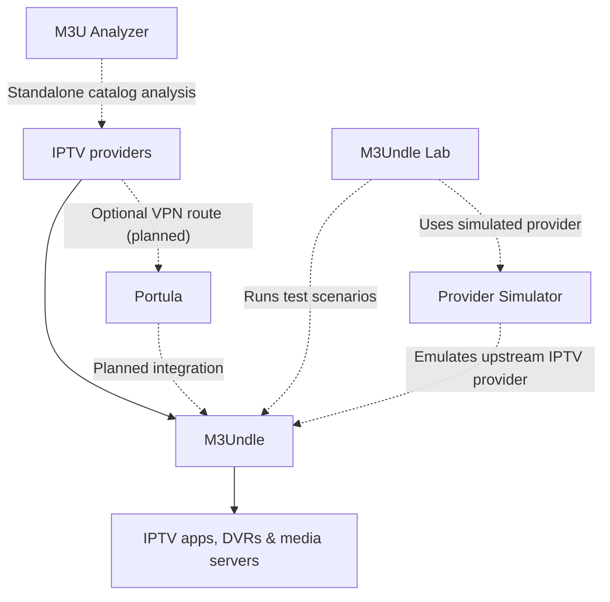

# Sydney-Elvis

**Open-source IPTV software, from provider connection to playback.**

Tools for organizing provider catalogs, building channel lineups, improving EPG data, testing streaming behavior, and delivering live television to DVRs and media servers.

[M3Undle](https://github.com/Sydney-Elvis/M3Undle) · [Documentation](https://sydney-elvis.github.io/M3Undle/) · [Discussions](https://github.com/Sydney-Elvis/M3Undle/discussions) · [♥ Sponsor](https://github.com/sponsors/Sydney-Elvis) · [☕ Coffee for the maintainer](https://buymeacoffee.com/jake1164s)

## M3Undle — the flagship

**Turn oversized IPTV provider lists into lineups your apps can actually use.** M3Undle is a self-hosted lineup manager and proxy for M3U, XMLTV, Xtream, and compatible IPTV sources. Organize channels, manage guide data, and publish selected lineups to DVRs, media servers, and IPTV apps.

[Explore M3Undle](https://github.com/Sydney-Elvis/M3Undle) · [Install with Docker](https://sydney-elvis.github.io/M3Undle/getting-started/install-with-docker/) · [Release notes](https://github.com/Sydney-Elvis/M3Undle/releases)

## The IPTV ecosystem

*The diagram illustrates the product direction. Portula-to-M3Undle integration is planned, not a released feature.*

### Applications and integrations

- **[M3U Analyzer](https://github.com/Sydney-Elvis/M3U-Analyzer)** — Explore and compare IPTV provider catalogs, channel coverage, and guide data.
- **[Portula](https://github.com/Sydney-Elvis/Portula)** — Manage VPN egress gateways for selected application traffic. Intended for IPTV provider routing with M3Undle. **Early development.**

### Developer tools

- **[M3Undle Lab](https://github.com/Sydney-Elvis/m3undle-lab)** — Runs deterministic integration-test scenarios against M3Undle, using simulated IPTV providers.
- **[Provider Simulator](https://github.com/Sydney-Elvis/M3Undle-provider-simulator)** — Emulates an upstream IPTV provider, including API responses, stream stalls, HTTP errors, and broken streams. M3Undle Lab uses it during testing.
- **[M3Undle CLI](https://github.com/Sydney-Elvis/m3undle-cli)** — Command-line adapter for M3Undle workflows; currently relies on a private core package.

## Get involved

Found a compatibility problem or have an idea for a DVR or IPTV client? **[Start a discussion](https://github.com/Sydney-Elvis/M3Undle/discussions)**, **[report an issue](https://github.com/Sydney-Elvis/M3Undle/issues)**, or **[contribute](https://github.com/Sydney-Elvis/M3Undle/blob/main/CONTRIBUTING.md)**.

## Support development

These projects are independently maintained and shared as open source. A star, bug report, contribution, or donation helps keep them moving.

Maintained by [Jason](https://github.com/jake1164)
